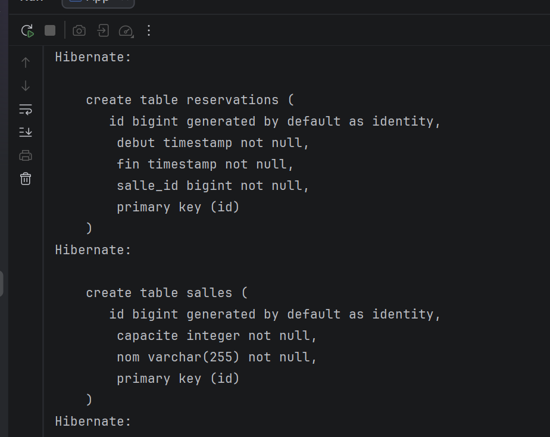
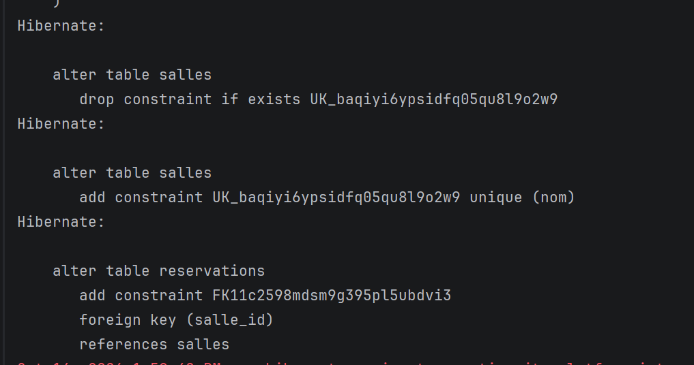
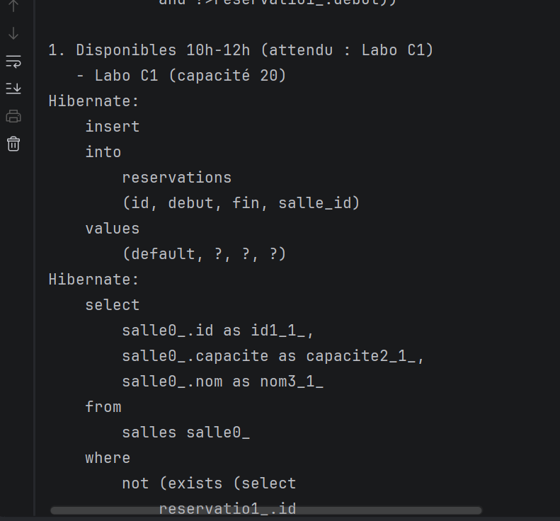
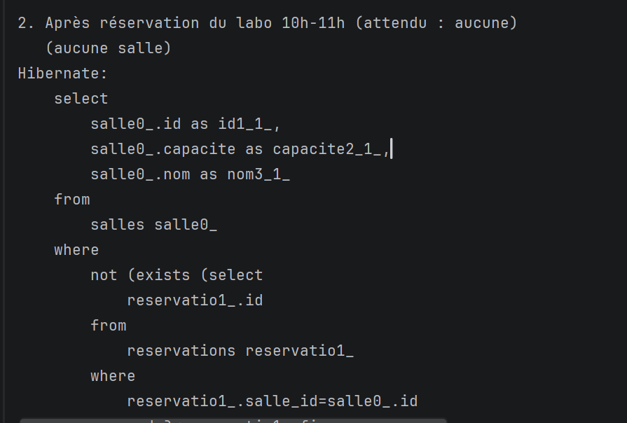
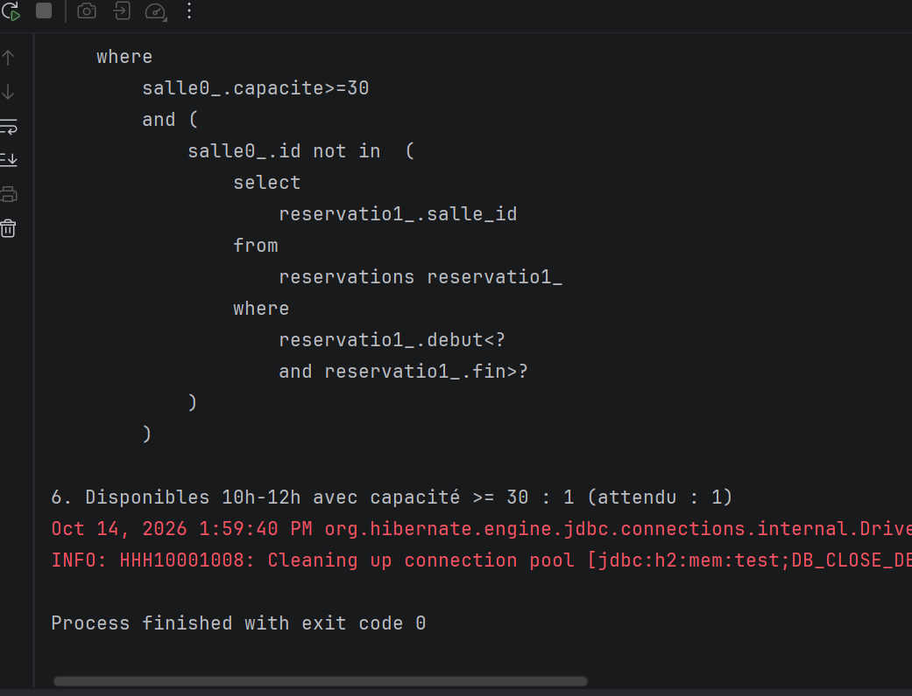

# Lab 5 – Gestion des salles (JPA / Hibernate / Criteria API)

Application Java SE de gestion et de recherche de salles avec réservations, réalisée dans le cadre du module **JEE Microservice**. Elle utilise **JPA 2.2** avec **Hibernate 5.6** et une base **H2 en mémoire**.

Le lab met l'accent sur :

- la détection des salles **disponibles** sur un créneau (requête JPQL avec `NOT EXISTS`) ;
- une **recherche multicritère** construite dynamiquement avec la **Criteria API** (nom, capacité minimale, disponibilité) ;
- la **pagination** des résultats (liste + nombre total + nombre de pages) ;
- une architecture en couches **Repository → Service**.

## Stack technique

| Élément | Version |
|---|---|
| Java | 17 |
| Maven | 3.x |
| JPA (`javax.persistence-api`) | 2.2 |
| Hibernate Core | 5.6.15.Final |
| H2 Database | 2.2.220 |
| EJB / Inject API | 3.2 / 1 |
| JAXB (requis par Hibernate 5 avec Java 11+) | 2.3.1 / 2.3.8 |
| JUnit | 4.13.2 |

## Structure du projet

```
lab5/
├── pom.xml
├── docs/img/                          # captures d'exécution
└── src/
    ├── main/
    │   ├── java/com/example/
    │   │   ├── App.java               # scénarios de démonstration
    │   │   ├── model/
    │   │   │   ├── Salle.java         # entité Salle
    │   │   │   └── Reservation.java   # entité Reservation
    │   │   ├── repository/
    │   │   │   ├── SalleRepository.java
    │   │   │   └── SalleRepositoryImpl.java   # JPQL + Criteria API
    │   │   ├── service/
    │   │   │   ├── SalleService.java
    │   │   │   └── SalleServiceImpl.java      # règles métier
    │   │   └── util/
    │   │       └── PaginationResult.java      # résultat paginé générique
    │   └── resources/META-INF/
    │       └── persistence.xml        # unité de persistance « SallePU »
    └── test/java/com/example/AppTest.java
```

## Modèle de données

Relation **un-à-plusieurs** : une `Salle` possède plusieurs `Reservation`.

| Table `salles` | Type | Contraintes |
|---|---|---|
| `id` | bigint | clé primaire, auto-généré (identity) |
| `nom` | varchar(255) | `NOT NULL`, `UNIQUE` |
| `capacite` | integer | `NOT NULL` |

| Table `reservations` | Type | Contraintes |
|---|---|---|
| `id` | bigint | clé primaire, auto-généré (identity) |
| `debut` | timestamp | `NOT NULL` |
| `fin` | timestamp | `NOT NULL` |
| `salle_id` | bigint | `NOT NULL`, clé étrangère vers `salles` |

Mapping : `@OneToMany(mappedBy = "salle", cascade = ALL, fetch = LAZY)` côté `Salle`, `@ManyToOne(fetch = LAZY)` côté `Reservation`.

## Fonctionnalités

### Repository (`SalleRepositoryImpl`)

- **`findAvailableRooms(debut, fin)`** : salles sans aucune réservation qui chevauche le créneau (JPQL avec sous-requête `NOT EXISTS`).
- **`searchRooms(nom, capaciteMin, debut, fin, page, size)`** : recherche dynamique via Criteria API, triée par nom, paginée (page numérotée à partir de 1).
- **`countRooms(nom, capaciteMin, debut, fin)`** : nombre total de résultats avec les mêmes filtres.
- Les prédicats sont construits dans une méthode commune (`buildPredicates`) réutilisée par la recherche et le comptage. Chaque filtre est optionnel : un paramètre `null` est ignoré.

### Test de chevauchement

Deux créneaux se chevauchent si :

```
nouveau.debut < existant.fin  ET  nouveau.fin > existant.debut
```

Les créneaux **adjacents** (ex. 10h-11h puis 11h-12h) ne sont donc pas considérés comme en conflit.

### Service (`SalleServiceImpl`)

- Délègue au repository et applique les règles métier :
  - `debut` doit être strictement avant `fin` ;
  - `page` et `size` doivent être >= 1.
- **`findPaginated(...)`** renvoie un `PaginationResult<Salle>` contenant les éléments, la page courante, la taille de page, le nombre total d'éléments et le nombre total de pages.

## Lancer le projet

### Prérequis

- JDK 17
- Maven 3.x

### Compilation

```bash
mvn clean compile
```

### Exécution des scénarios

```bash
mvn exec:java -Dexec.mainClass="com.example.App"
```

Ou directement depuis IntelliJ IDEA : clic droit sur `App.java` → **Run 'App.main()'**.

### Tests

```bash
mvn test
```

## Scénarios de démonstration (`App.java`)

Jeu de données de départ (date du 15/10/2026) :

| Salle | Capacité | Réservations |
|---|---|---|
| Amphi 1 | 100 | 9h-11h, 14h-16h |
| Salle B1 | 30 | 10h-12h |
| Labo C1 | 20 | aucune |

| # | Scénario | Résultat attendu |
|---|---|---|
| 1 | Salles disponibles 10h-12h | Labo C1 |
| 2 | Après réservation du Labo C1 de 10h à 11h | aucune salle |
| 3 | Créneaux adjacents : disponibles 11h-14h | Amphi 1, Labo C1 |
| 4 | Navigation `Salle` → `Réservations` (chargement paresseux après `em.clear()`) | 2 réservations pour Amphi 1 |
| 5 | Après annulation de la réservation de Salle B1 | Salle B1 |
| 6 | Filtres combinés : disponibles 10h-12h avec capacité >= 30 | 1 salle |

## Résultats d'exécution

### Création du schéma par Hibernate (`hbm2ddl.auto=update`)



### Contraintes d'unicité et clé étrangère



### Scénario 1 : salles disponibles de 10h à 12h



### Scénario 2 : après réservation du labo



### Scénario 6 : filtres combinés (Criteria API) et fin d'exécution

La requête générée combine `capacite >= 30` et `id NOT IN (sous-requête sur les réservations)`. Le programme se termine avec le code `0`.



## Points clés à retenir

- **JPQL** pour une requête fixe et lisible (`findAvailableRooms`), **Criteria API** pour une requête dont les filtres varient (`searchRooms`).
- Le **comptage** et la **recherche** reconstruisent leurs prédicats sur leur propre racine pour éviter de partager une `Root` entre deux requêtes.
- `FetchType.LAZY` sur les deux associations : les réservations ne sont chargées qu'à l'accès.
- Le service reste utilisable en Java SE (constructeur avec injection manuelle) et dans un conteneur EJB (`@Stateless`, `@Inject`).

## Auteure

**Dihi Fatima** – EMSI Marrakech, 5e année Développement Digital et Systèmes d'Information
